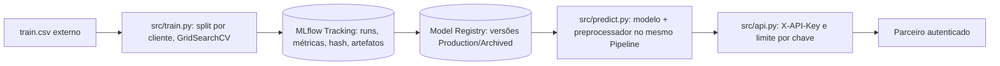

# Entregável 1 — template do repositório

```
quantumfinance-credit-score/
├── .env.example             # variáveis sem segredos
├── .gitignore               # protege dados, artefatos, .env e ambientes
├── requirements.txt         # dependências Python
├── README.md                # inicialização rápida
├── data/
│   ├── raw/README.md        # CSV original fora do Git/ZIP; caminho externo
│   ├── raw/demo_train.csv   # CSV demo sintético (esquema do Kaggle, sem PII)
│   └── processed/README.md  # snapshots futuros; pipeline atual prepara em memória
├── examples/
│   ├── cliente.json         # exemplo para API local (campos crus)
│   └── azure_endpoint_input.json # exemplo com 58 features para score.py do Azure
├── notebooks/
│   ├── README.md            # notebook original fica fora do ZIP por privacidade
│   └── execucao_api.ipynb   # execução real da API com logs (já executado)
├── requirements-notebook.txt # opcional: ferramentas Jupyter p/ reexecutar o notebook
├── models/
│   ├── README.md            # explica o modelo embalado e o Registry
│   └── credit-score-v1/     # v1 promovida, autocontida; entra só no ZIP
├── deploy/apim-policy.xml   # política rate-limit APLICADA no APIM (docs/throttling_azure.md)
├── src/
│   ├── features.py          # limpeza/engenharia; Pipeline fit apenas no treino
│   ├── registry.py          # mesmo MLflow para treino e inferência
│   ├── train.py             # entregável 2: grupos, CV, runs, avaliação, promoção
│   ├── predict.py           # entregável 3: consulta Production, CLI + biblioteca
│   └── api.py               # API FastAPI, chave, limite e erros
├── tests/                   # testes unitários/contrato
├── tools/
│   ├── setup_local.py       # bootstrap cross-platform (.venv + seed)
│   ├── seed_registry.py     # registra o modelo embalado como Production
│   ├── export_model.py      # reexporta Production para models/credit-score-v1/
│   ├── gerar_demo_csv.py    # gera data/raw/demo_train.csv (sintético)
│   ├── gerar_notebook.py    # gera notebooks/execucao_api.ipynb
│   ├── validate_local.py    # teste HTTP do servidor local após promoção
│   └── gerar_evidencias.py  # grava logs, JSON e capturas em docs/evidencias/
├── docs/
│   ├── arquitetura.md       # entregável 1
│   ├── api.md               # entregável 4
│   ├── validacao_local.md   # métricas e 200/401/429 observados na API local
│   ├── checklist_capturas_azure.md  # capturas do portal: caminho, arquivo e privacidade
│   ├── evidencias/          # capturas PNG, log/JSON do consumo real + logs do notebook
│   └── throttling_azure.md  # limitação por parceiro no APIM (aplicado e testado com 429)
└── mlruns/                  # gerado em execução, fora do Git/ZIP
```

O notebook original `analise_score_credito.ipynb` e o Kaggle **Credit Score Classification** (train.csv) foram consultados em `https://www.kaggle.com/datasets/parisrohan/credit-score-classification?select=train.csv`. O conjunto contém `Customer_ID`, `Name` e `SSN`: **não é publicado**. O notebook e suas três famílias de classificadores (Random Forest, XGBoost e LightGBM) orientam o código; o pipeline aqui é adaptado para impedir vazamento de informação e assegurar inferência idêntica ao treino. Não se afirma que o dataset contém transações bancárias reais atualizadas: é o snapshot acadêmico fornecido; atualizações futuras exigem novo CSV com o mesmo esquema e governança de consentimento.



## Governança e ciclo de vida

- O treinamento usa `GroupShuffleSplit(20%)` e `GroupKFold(3)` por `Customer_ID`: meses do mesmo cliente não atravessam os conjuntos. Identificadores e target nunca entram como features.
- **Cada candidato** gera uma run: parâmetros vencedores e CV, F1 ponderado de treino/validação, acurácia, gap, CSV da matriz de confusão, relatório por classe e *modelo Pipeline serializado*. Tags: SHA-256 do arquivo de origem, quantidade de linhas, nome da família, ordem das classes e tamanhos de conjuntos. Não publica o CSV nem dados identificáveis como artefatos.
- F1-weighted foi escolhido pelo desbalanceamento das classes `Good`, `Poor` e `Standard`. O treino registra relatório por classe para também acompanhar erros na classe de maior risco; não deve fundamentar aprovação automática de crédito sem revisão humana.
- Escolha: F1 validação >= 0,70. Em diferença menor que 0,005 entre candidatos, vence o de menor gap absoluto treino/validação. Com versão existente, novo vencedor deve superar o desempenho **desta mesma versão no mesmo holdout** em pelo menos 0,005; caso contrário, nada muda. A versão anterior permanece servida se nenhuma nova for promovida.
- O MLflow incrementa o número ao registrar o vencedor e o move para `Production`, arquivando a produção anterior. A API reconsulta o Registry por requisição e só recarrega o modelo quando a versão muda; retorna o número realmente carregado. Para uso local ambos os processos usam `./mlruns` (caminho absoluto calculado no código). Em ambientes remotos, configurar o **mesmo** `MLFLOW_TRACKING_URI` para todos.
- O serviço local limita 60/min e 10/s por chave **por processo**. Para múltiplas réplicas é obrigatório trocar por quota centralizada (gateway/Redis) e TLS; não se afirma que a solução local está publicada em nuvem.
